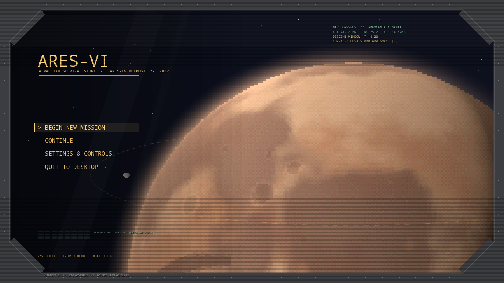
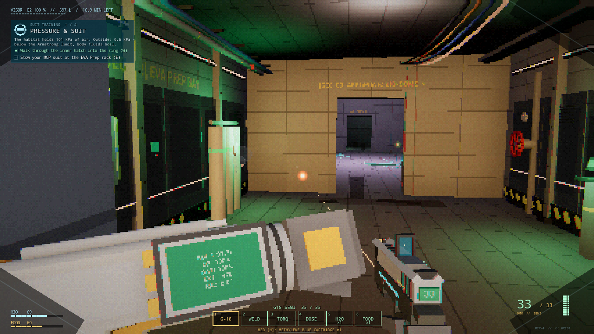
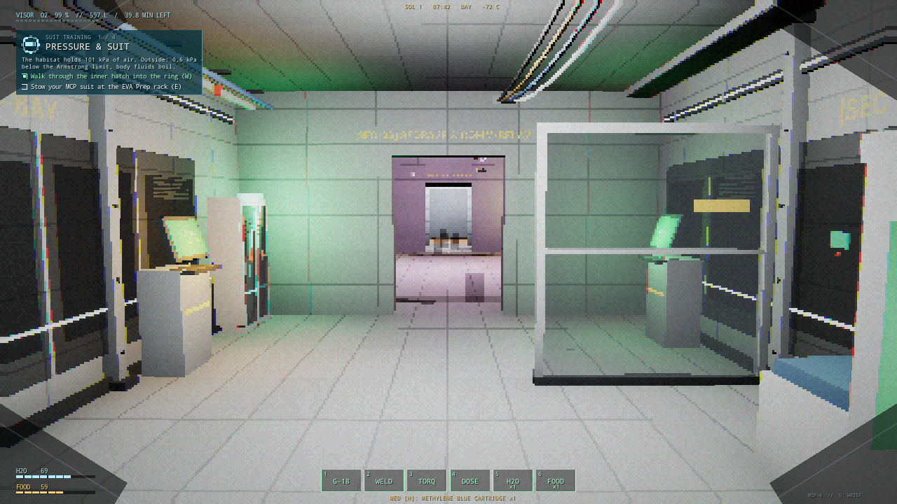
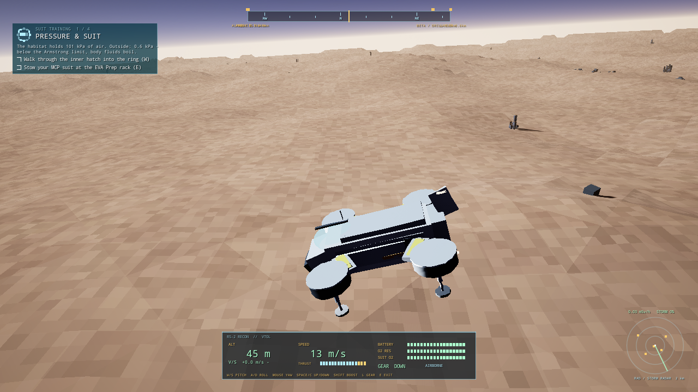

# ARES-VI

**A hard sci-fi psychological survival horror game set on Mars in 2087.**
Developed by **Team Paradox** in Unreal Engine 5.3 and C++. Internal project name: `MarsSurvival`.



> **Just want to play?** Once the first demo is published, download the Windows build from the [Releases](https://github.com/Lit4alrt7/ARES-VI/releases) page and follow [INSTALL.md](INSTALL.md). You won't need Unreal Engine.

---

## Table of contents

- [Overview](#overview)
- [Concept](#concept)
- [Design pillars](#design-pillars)
- [Features](#features)
- [Gameplay mechanics](#gameplay-mechanics)
- [Technologies used](#technologies-used)
- [Installation and setup](#installation-and-setup)
- [Controls](#controls)
- [Screenshots](#screenshots)
- [Development roadmap](#development-roadmap)
- [Project structure](#project-structure)
- [Documentation](#documentation)
- [Contributing](#contributing)

---

## Overview

You play Dr. David Miller, a bio-engineer and the only crew member left at the **Ares-IV** surface outpost on Mars. You have to keep the station alive, survive your own failing body, and send a message to Earth.

The game is first-person and runs in Mars gravity (0.38 g). The whole world is built procedurally in C++, from the station modules and props to the terrain, the audio and the Mars globe on the main menu. It uses a deliberate PS1-era look: vertex jitter, affine texture warping, Bayer dithering and CRT scanlines.

## Concept

**There are no monsters.** Perchlorate poisoning, carbon dioxide build-up, cosmic radiation and a neuro-active extremophile slowly push the player into hallucinations: footsteps, knocking on the hull, whispers, shadow figures, voices on the radio.

The horror comes from not knowing what is real. The phantoms can be shot, and shooting one gives you a moment of clarity. But the bullet keeps going and punctures the habitat wall behind it, so you now have a hull leak to weld shut.

The habitat computer, **A.R.I.A.**, is your only company. It is cold and clinical, it only trusts its sensors, and it will tell you plainly that no one else is on the base.

## Design pillars

1. **The body is the enemy.** Every threat is physiological or environmental: poison, CO2, radiation, cold, vacuum. Nothing is scripted to jump out at you.
2. **Doubt your senses.** Real station noises and hallucinated ones sound alike. The only reliable witness is a machine with no empathy.
3. **Every action has a physical cost.** A bullet fired at a phantom is still a hole in a pressure hull. Repairs, power and medicine all compete for the same scarce resources.
4. **Grounded science.** Pressure, heat loss, seal embrittlement, methaemoglobin and dose are modelled with plausible numbers, then tuned for play.
5. **Lo-fi on purpose.** A PS1-era look and fully procedural audio keep the focus on atmosphere and make the build small.

## Features

- **Physically modelled habitat.** Each pressurised module simulates pressure loss through bullet holes, hull breaches and cold-cracked seals, plus heating against the Martian night, CO2 build-up and life-support repressurisation.
- **Four-stage disease system.** Methaemoglobin, radiation dose and an extremophile bio-load push the player through four disease stages, from mild symptoms to systemic collapse with a lethal countdown.
- **Hallucination system.** Hallucination intensity is built from radiation, hypoxia, hypercapnia, acute dose rate and panic. It triggers phantoms (audio and visual), Cherenkov-style light flashes and post-process distortion.
- **"Ballistic awakening".** Shooting a phantom collapses it into ash and briefly restores clarity. The round then holes the bulkhead behind it.
- **A.R.I.A. habitat computer.** A sensor-bound station character that reports on telemetry periodically, reacts to breaches, gunfire and critical vitals, and answers when you talk to it (T).
- **Three-chapter story** paced by Sols (Martian days), with a day/night cycle, dust storms and solar particle events.
- **RS-2 recon shuttle** that you can fly (VTOL) to three survey sites on the procedural Martian surface.
- **Survival needs.** Suit O2 and battery, hydration, nutrition, stamina, fatigue and sleep.
- **Tools and equipment.** A Glock-18 with semi/full-auto fire selector, a weld/sealant gun, a torque wrench, a Geiger dosimeter, a med-kit, O2 canisters and deployable surface beacons.
- **Interactive stations** with live in-world screens, including a diagnostic scanner bed, bioprinter, xeno-analyzer, CO2 scrubber, RTG core, power routing, comm-relay and dish alignment.
- **Fully procedural audio.** Real-time DSP synthesis. The game ships no sound files.
- **Save system** with automatic checkpoints and manual saves at Mission Log terminals.
- **Settings menu** with rebindable keys, camera, audio, display and gameplay options.

## Gameplay mechanics

### Story structure

The game starts calmly on Sol 1 at 07:30. The story director tracks one objective at a time:

| Chapter | Sols | Objectives |
|---|---|---|
| **I: Stabilisation** | 1–2 | Complete SV-4 suit training · open the supply lockers in SEC-06 Storage & Comm · run a Comm-Relay diagnostic · sleep in the SEC-07 Crew Quarters bunk · decode the black-box signal · board the Recon Shuttle |
| **II: The Survey** | 3–4 | Fly to Beacon ALPHA (crashed relay satellite R-3) · Beacon BETA (deep ice-core drill rig) · the abandoned ARES-III outpost · return and rest before storm season |
| **III: The Uplink** | 5+ | Install the quantum transistors · repair the transceiver with spare parts · align the dish (hold E to 100 %) · transmit the truth about Ares-IV to Earth |

Floor holo-chevrons and an on-screen marker point at the current objective (toggle them with **N**).

**Win:** establish the quantum link with Earth.
**Lose:** the crew member dies (for example from lethal methaemoglobin, severe hypoxia, hypercapnic unconsciousness, acute radiation syndrome or ebullism).

### Disease stages

Check your stage at the Med-Bay diagnostic scanner bed. The HUD does not show it. Any one of these pathways can push you into a stage:

| Stage | MetHb % | Radiation (mSv) | Bio-load | Countermeasures |
|---|---|---|---|---|
| 1 Prodromal | 3–10 | 50–150 | 0.15 | Potassium iodide pills, O2 |
| 2 Acute MetHb / hypercapnia | 10–25 | 150–400 | 0.40 | Methylene blue (bioprinter), CO2 scrubbing |
| 3 Neuro-toxic encephalopathy | 25–45 | 400–750 | 0.70 | Xeno-analyzer assay of a bio-agent culture → Neuro-Antitoxin, Amifostine |
| 4 Systemic collapse | > 45 | > 750 | > 0.85 | Hold E on the scanner bed for emergency stabilisation |

### Habitat simulation

The station modules are Airlock & Decon, EVA Prep, Aeroponic Bio-Dome, Xenobiology Lab, Medical Bay, Storage & Comm-Relay, Ring Corridor and Crew Quarters. Each one tracks its own pressure, temperature, hull and seal integrity, CO2 and leaks. Simulation runs at 60× speed: one real second is one game minute, and one Sol is 24 real minutes.

- Nights fall to about −80 °C, occasionally −100 °C. Below a critical temperature the elastomer seals stiffen and start to leak unless seal heaters are on.
- Every bullet adds a hole. Below 35 % hull integrity the module breaches catastrophically.
- Repairs: patch punctures, weld the hull, service the seals.
- The **power routing terminal** cycles the RTG between Even Split, Airlock/EVA/Quarters, Med-Bay, Bio-Dome and Comm-Relay priority. The non-priority sectors dim.

### Suit and survival

- Outside, the suit heater drains the battery, twice as fast below −60 °C. It recharges inside the base.
- The shuttle has its own battery and O2 reserve and tops up your suit while you are seated.
- Hydration, nutrition and stamina drain over time. Fatigue builds while you are awake. Sleep at the bunk, or use the rest terminal to wait until 06:00, 12:00, 18:00 or 22:00.

### Saving

- **Automatic checkpoints** every 4 minutes while you are inside a pressurised module and not in Stage 4.
- **Manual saves** at the MISSION LOG terminals.
- **Load** with CONTINUE on the main menu, or LOAD LAST SAVE in the pause menu.

For more detail, see [Documentation/Gameplay.md](Documentation/Gameplay.md).

## Technologies used

| Area | Technology |
|---|---|
| Engine | Unreal Engine **5.3** |
| Language | **C++** (gameplay, UI, audio, world generation), **Python** (editor bootstrap script) |
| Toolchain | Visual Studio 2022, MSVC toolset **14.44.35207** (pinned in `*.Target.cs`) |
| Engine plugins | `ProceduralMeshComponent`, `PythonScriptPlugin`, `EditorScriptingUtilities` |
| Engine modules | Core, Engine, InputCore, UMG, Slate/SlateCore, AudioMixer, HTTP, Json/JsonUtilities |
| A.R.I.A. | Built-in offline report generator. An optional online mode for developers is described in [ARIA-Integration.md](Documentation/ARIA-Integration.md) |
| Packaging | `Scripts/Package-Windows.ps1` (Unreal Automation Tool `BuildCookRun`, Shipping, Win64) |
| Rendering | Custom PS1 post-process and surface materials. Lumen, Virtual Shadow Maps, anti-aliasing and motion blur are disabled |
| Audio | Procedural real-time synthesis (`UMarsProceduralSynth`). No audio assets |
| Platform | Windows 64-bit |

## Installation and setup

### Requirements

- Windows 10/11, 64-bit
- **Unreal Engine 5.3** (Epic Games Launcher)
- **Visual Studio 2022** with the *Game development with C++* workload and the **MSVC v14.44.35207** toolset. UE 5.3 does not support the MSVC 14.5x toolset that ships with VS 2026, so the targets pin this version.
- **Git LFS**. The main map `AresStation.umap` is about 235 MB, which is over GitHub's 100 MB file limit.

### Steps

```bash
git lfs install
git clone <repository-url> MarsSurvival
cd MarsSurvival
```

1. Right-click `MarsSurvival.uproject` and choose **Generate Visual Studio project files**.
2. Open `MarsSurvival.sln`, select **Development Editor | Win64**, and build.
   Or open `MarsSurvival.uproject` directly and accept the prompt to rebuild the module.
3. The editor opens on `/Game/MarsSurvival/Maps/AresStation`. Press **Play**.

If the materials or the map are missing (for example, if you cloned without LFS), regenerate them in the editor with
**Tools → Execute Python Script →** `Content/Python/setup_mars_project.py`. The script can safely be run again.


### Building a playable Windows release

```powershell
powershell -ExecutionPolicy Bypass -File Scripts\Package-Windows.ps1 -EngineDir "C:\Program Files\Epic Games\UE_5.3"
```

This compiles, cooks and packages a Shipping build into `Release\ARES-IV\` and zips it as `Release\ARES-IV-Win64.zip`, ready to upload to a GitHub Release. See [Documentation/Releasing.md](Documentation/Releasing.md) for the options and the release checklist.

### Launcher scripts

`Open_MarsSurvival.bat` (editor) and `Play_MarsSurvival.bat` (standalone game, 1600×900 windowed) are included. They contain **hard-coded paths** (`D:\Program Files\Epic Games\UE_5.3`, `D:\Dev\MarsSurvival`) and redirect temp/DDC to `D:\Dev`. Edit them to match your machine before you use them.

## Controls

All keys can be rebound in **Settings & Controls**, from the main menu or the pause menu.

### On foot

| Key | Action |
|---|---|
| W A S D | Move |
| Mouse | Look |
| Space | Jump |
| Left Shift | Sprint (uses stamina) |
| C | Crouch (maintenance ducts) |
| E | Interact · hold for hold-actions |
| Left mouse | Use tool / fire |
| Right mouse | Secondary action (Glock fire selector) |
| R | Reload |
| 1 / 2 / 3 / 4 | Glock-18 · Weld/sealant gun · Torque wrench · Dosimeter |
| 5 / 6 | Drink water · Eat |
| X | Holster |
| H | Med-kit: tap to select medication, hold to inject |
| Q | Use O2 canister |
| B | Deploy surface beacon |
| T | Talk to A.R.I.A. |
| G | Wrist computer |
| N | Toggle navigation waypoints |
| U | Toggle minimal HUD |
| Esc | Pause menu |

### RS-2 recon shuttle

| Key | Action |
|---|---|
| W / S | Pitch |
| A / D | Roll |
| Mouse | Yaw |
| Space / C | Climb / descend |
| Shift | Boost |
| L | Landing gear |
| E | Exit (when landed) |

## Screenshots

| | |
|---|---|
|  |  |
| *EVA Prep: Glock-18, wrist computer and belt HUD* | *Station interior with diegetic terminals* |
|  |  |
| *RS-2 recon shuttle over procedural terrain* | *Main menu* |

In-engine screenshots can be captured with the `-AutoShot` launch flag (see [Documentation/Developer-Tools.md](Documentation/Developer-Tools.md)).

## Development roadmap

The current build plays all three chapters. These items come from what is in the code today:

- [ ] **Epilogue chapter.** `EMarsChapter::Epilogue` exists, but no story steps are defined for it yet.
- [ ] **Stale fallback objective text.** The pause menu's fallback objective still mentions a "crashed lander ~650 m out", which the current world no longer spawns. Transistors now come from Storage, relay R-3 and the drill rig.
- [ ] **Optional comm-window timer.** `AMarsGameMode::CommWindowMinutes` supports a hard time limit, but it is set to `0` (off). Decide whether to enable and tune it.
- [ ] **Custom intro music.** The game plays `Content/Audio/IntroTheme.wav` if it exists (slowed 0.82× with reverb). Right now it falls back to a procedural theme.
- [ ] **Imported low-poly models.** Every prop is currently built procedurally by `AMarsPropBuilder`. Imported models can use `M_PS1_Surface` / `MI_HullPanel` to keep the same look.
- [ ] **Portable launchers.** Replace the hard-coded `D:\` paths in the `.bat` files.
- [ ] **First public demo release.** A packaging script now exists (`Scripts/Package-Windows.ps1`). The packaged build still needs a full playtest before it's uploaded to Releases.

## Project structure

```
MarsSurvival/
├── MarsSurvival.uproject
├── INSTALL.md                  Player guide: download, unzip, launch
├── Config/                     Engine, game and input settings
├── Content/
│   ├── MarsSurvival/Maps/      AresStation.umap (Git LFS)
│   ├── MarsSurvival/Materials/ PS1 post-process, surface, glass, phantom materials
│   ├── Python/                 setup_mars_project.py (editor bootstrap)
│   └── UI/                     Splash logo and team poster
├── Source/MarsSurvival/
│   ├── AI/                     A.R.I.A. subsystem, report generation, optional online client
│   ├── Audio/                  Procedural synth, audio manager, A.R.I.A. voice
│   ├── Base/                   Habitat modules (pressure, thermal, seals, CO2)
│   ├── Core/                   Game mode, narrative director, save game, settings, tutorial
│   ├── Equipment/              Glock-18, bullets, tools, impact FX
│   ├── Hallucination/          Hallucination director and phantoms
│   ├── Items/                  Item types, inventory, pickups
│   ├── Player/                 Character, biometrics, EVA suit, fatigue, viewmodel
│   ├── Props/                  Procedural prop builder
│   ├── Rendering/              Retro post-process driver
│   ├── Stations/               Interactive stations and terminals
│   ├── UI/                     HUD, splash/menu, briefing, pause menu, settings
│   ├── Vehicles/               RS-2 recon shuttle
│   └── World/                  Station/terrain/surface generators, environment, storms, base manager, beacons
├── Scripts/                    Package-Windows.ps1 / .bat (release packaging)
└── Documentation/              Design and technical docs, screenshots
```

## Documentation

| Document | Contents |
|---|---|
| [Architecture](Documentation/Architecture.md) | Code layout, main classes and how they connect |
| [Gameplay](Documentation/Gameplay.md) | Systems in depth: disease, habitat, suit, story, saving |
| [A.R.I.A. integration](Documentation/ARIA-Integration.md) | How A.R.I.A. builds its reports, offline and optional online mode |
| [Developer tools](Documentation/Developer-Tools.md) | Console commands, launch flags, Python bootstrap |
| [Releasing](Documentation/Releasing.md) | Packaging a Windows build and publishing a GitHub Release |
| [INSTALL.md](INSTALL.md) | Player guide for the downloadable demo |

## Contributing

See [CONTRIBUTING.md](CONTRIBUTING.md).

---

*ARES-VI is developed by Team Paradox.*
